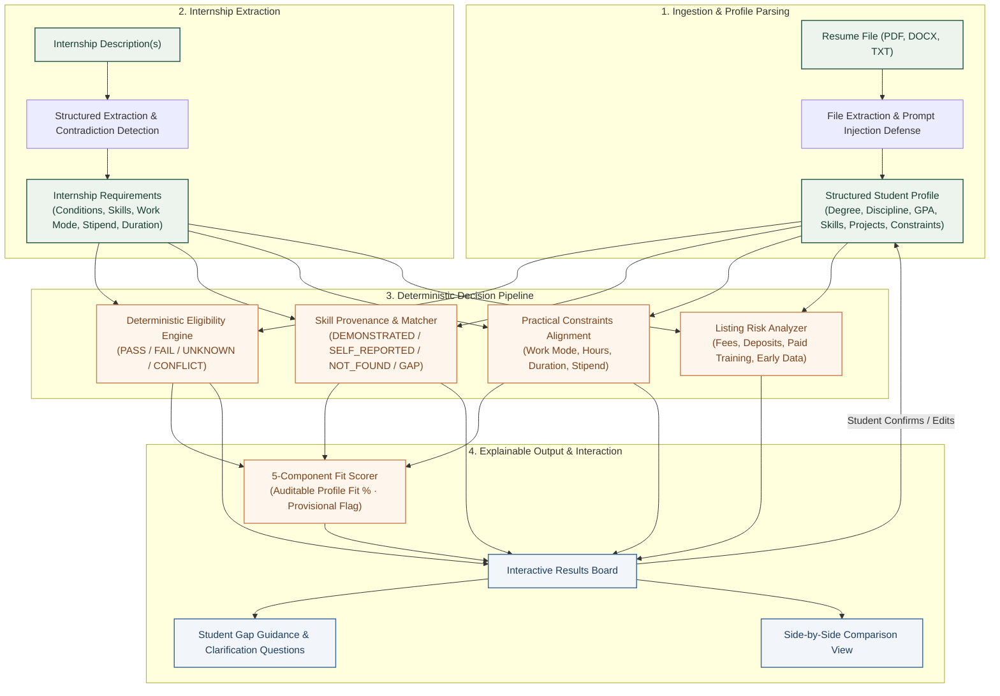

<div align="center">

# 🎓 JobMatch AI

### Intelligent Internship Matching & Evidence-Backed Eligibility Assistant

[](https://fastapi.tiangolo.com)
[](https://react.dev)
[](https://vitejs.dev)
[](https://python.org)
[](#-automated-testing--scenario-matrix)
[](#-deterministic-hard-eligibility-engine)
[](#-design-system)
[](LICENSE)

<p align="center">
  <b>A student-side decision-support tool.</b><br/>
  Evaluate explicit academic eligibility, audit skill evidence, align practical constraints, and inspect listing warnings — with transparent rationales, never an opaque percentage.
</p>

[**Quickstart**](#-quickstart) · [**Why JobMatch AI?**](#-why-jobmatch-ai) · [**Architecture**](#-architecture--workflow) · [**Scoring**](#-explainable-fit-scoring-model) · [**Tests**](#-automated-testing--scenario-matrix) · [**API**](#-api-reference) · [**Design**](#-design-system)

</div>

---

> [!NOTE]
> **Product Positioning & Philosophy**  
> JobMatch AI helps students decide which internships are genuinely worth pursuing and what they should clarify or improve before applying. It does **not** predict selection probability, guarantee an interview, verify an employer's legal status, or make hiring decisions. It is designed to empower students with auditable evidence and total control over their data.

---

## 💡 Why JobMatch AI?

Traditional ATS tools and resume matchers treat candidates as a bag of keywords and produce opaque, uninterpretable percentages. JobMatch AI redesigns this from the **student's perspective**:

| Dimension | Generic ATS / Keyword Scrapers | JobMatch AI (Student-Side Assistant) |
|---|---|---|
| **Academic Eligibility** | Conflates skill similarity with hard eligibility conditions. | **Independent Deterministic Engine:** Evaluates degrees, semesters, GPA thresholds, and graduation windows under strict boolean `AND`/`OR` logic. |
| **Missing Keywords** | Assumes absence of keyword = student lacks the skill. | **Evidence Provenance:** Distinguishes `DEMONSTRATED`, `SELF_REPORTED`, `NOT_FOUND_IN_RESUME`, and `CONFIRMED_GAP`. |
| **Match Score Meaning** | Black-box "88% probability of hire" (false precision). | **Explainable 5-Component Score:** Weighted, inspectable components; cannot override ineligibility; marked `Provisional` if unverified. |
| **Practical Constraints** | Ignores student timetable, stipend needs, and commute. | **First-Class Constraints:** Compares remote/hybrid/on-site mode, hours/week, duration, and minimum stipend. |
| **Listing Safety** | Displays scam and fraudulent postings indiscriminately. | **Warning Indicators:** Quotes exact triggering excerpts for application fees, security deposits, paid training, or early sensitive data. |
| **Student Control** | Read-only; cannot correct parsing errors. | **Interactive Corrections:** Students can edit extracted facts, confirm/dispute skills, and trigger instant re-analysis. |

---

## 🎨 Design system

The frontend uses an **"Instrument"** design system: warm paper `#F8F7F3`, ink text, a single blue accent `#1F4FD8`, IBM Plex Sans/Mono/Serif, 1px rules, 2px section rules, 4px radius, and hard offset shadows only on the hero specimen card and the analyze CTA. Status is never colour-only — every verdict ships an icon and a word. Neumorphism and glassmorphism are rejected for content surfaces on WCAG 2.2 AA grounds; neo-brutalist signals are used as accents. Full rationale, tokens, component patterns, and sources live in [`docs/design-research.md`](docs/design-research.md).

---

## 🔄 Architecture & Workflow

JobMatch AI follows a hybrid architecture: document parsing and heuristic entity extraction produce structured constraints, while **deterministic application code** evaluates eligibility rules and calculates fit scores.



---

## ✨ Core Features

### 1. Document Extraction & Entity Normalization
- Supports text-based **PDF**, **DOCX**, and **UTF-8 TXT** documents up to 5 MB.
- Treats resume and job-posting text strictly as untrusted data (no prompt injection execution).
- Normalizes degrees (`B.Tech`, `BCA`, `B.Sc`, `M.Tech`, `MCA`, `MBA`, `Diploma`) and academic disciplines.
- Normalizes technical skills using a canonical alias taxonomy (`JS` → `JavaScript`, while strictly ensuring `Java` ≠ `JavaScript`).

### 2. Deterministic Hard Eligibility Engine
Evaluates explicit mandatory conditions independently from skills:
- **Condition Types:** `degree`, `level`, `discipline`, `marks` (CGPA/percentage), `semester`, `year`, `graduation_date`, `enrolment`.
- **Condition States:** `PASS`, `FAIL`, `UNKNOWN` (never silently converted), `CONFLICT`.
- **Overall Outcomes:** `ELIGIBLE`, `NOT_ELIGIBLE`, `NEEDS_CONFIRMATION`, `NO_FORMAL_CRITERIA`.

### 3. Evidence-Backed Skill Provenance
- `DEMONSTRATED`: Substantiated by a project, work experience, certification, or coursework excerpt.
- `SELF_REPORTED`: Listed by the student without concrete project evidence.
- `NOT_FOUND_IN_RESUME`: Not mentioned; highlights room to add truthful documentation.
- `CONFIRMED_GAP`: Student explicitly verified they do not know the skill.

### 4. Listing Risk Indicators
Quotes exact triggering excerpts for: application/registration fees, security/equipment deposits, paid training as a condition, unconditional/guaranteed selection claims, premature sensitive-data requests, vague organization/missing responsibilities.

---

## 📊 Explainable Fit Scoring Model

The fit score is a configurable whole number from **0 to 100** labeled **Profile Fit** (never "probability of acceptance"):

$$\text{Profile Fit Score} = \text{round}\left( \frac{\sum_{i \in \text{Evaluable}} \text{Score}_i \times \text{Weight}_i}{\sum_{i \in \text{Evaluable}} \text{Weight}_i} \right)$$

| Component | Default Weight | Measurement & Evidence Source |
|---|:---:|---|
| **Required-Skill Evidence** | **30%** | Overlap of explicitly required skills; `DEMONSTRATED` (100% credit) vs `SELF_REPORTED` (75% credit). |
| **Preferred-Skill Relevance** | **15%** | Alignment with nice-to-have / bonus skills. Missing preferred skills do not affect hard eligibility. |
| **Project & Experience Evidence** | **25%** | Evidence that the candidate applied technologies in projects, coursework, or prior internships. |
| **Education Relevance** | **15%** | Alignment of degree and discipline with role domain (excluding hard conditions already checked). |
| **Practical Preference Fit** | **15%** | Alignment of work mode, location, weekly hours, duration, and minimum acceptable stipend. |

> [!IMPORTANT]
> **Scoring Safeguards**
> 1. **Cannot Override Ineligibility:** A `NOT_ELIGIBLE` candidate keeps that label regardless of a high skill score.
> 2. **Provisional Status:** When mandatory conditions remain `NEEDS_CONFIRMATION` or evaluable coverage is under 70%, the score is tagged **Provisional**.
> 3. **Non-Silent Coverage:** Components that cannot be evaluated display as *Not enough information* rather than silently defaulting to zero.

---

## 🚀 Quickstart

### Prerequisites

- **Python 3.10+**
- **Node.js 20+** and **npm**

### 1. Clone & Set Up the Backend

```bash
git clone https://github.com/Mariakevin/JobMatchAI.git
cd JobMatchAI

python3 -m venv .venv
source .venv/bin/activate          # Windows: .venv\Scripts\activate
pip install -r requirements.txt

uvicorn api.main:app --reload --port 8000
```

> API runs at `http://localhost:8000`; interactive Swagger docs at `http://localhost:8000/docs`.

### 2. Set Up the React Frontend

```bash
npm install
npm run dev
```

> Open `http://localhost:5173`. The Vite dev server proxies `/api` calls to the Python API on port 8000.

---

## 🧪 Automated Testing & Scenario Matrix

```bash
source .venv/bin/activate
python -m unittest discover -s tests
```

The suite covers unit tests, API integration tests, end-to-end user journeys, and all **16 mandatory test scenarios**:

| # | Scenario | Key Assertion | Status |
|:---:|---|---|:---:|
| 1 | Straightforward Eligible Student | `ELIGIBLE`, 0 unresolved | ✅ |
| 2 | Degree Mismatch | `NOT_ELIGIBLE` with exact reason | ✅ |
| 3 | Alternative Degrees | `ELIGIBLE`; degree condition passes | ✅ |
| 4 | Unknown Marks | `NEEDS_CONFIRMATION` (never `NOT_ELIGIBLE`) | ✅ |
| 5 | Resume Omission | Skill status `NOT_FOUND_IN_RESUME` | ✅ |
| 6 | Student-Confirmed Gap | Skill status `CONFIRMED_GAP` + guidance | ✅ |
| 7 | Alias Match | `JS` ↔ `JavaScript`; `Java` ≠ `JavaScript` | ✅ |
| 8 | Required vs Preferred | Affects preferred component only | ✅ |
| 9 | Compound Eligibility | Boolean `AND`/`OR` groups correct | ✅ |
| 10 | Graduation Window | Boundaries pass; outside years fail | ✅ |
| 11 | Contradictory Posting | `CONFLICT` + review warning | ✅ |
| 12 | Practical Mismatch | Work-mode mismatch; academic stays `ELIGIBLE` | ✅ |
| 13 | Unpaid Internship | Transparent unpaid status, no fraud claims | ✅ |
| 14 | Fee Request | Risk warning with exact quoted excerpt | ✅ |
| 15 | Prompt Injection | Treated as untrusted text; scoring uncompromised | ✅ |
| 16 | Low-Quality Scan | Clean HTTP 400/422 with guidance | ✅ |

```
Ran 72 tests in 0.199s
OK (72/72 tests passing)
```

---

## 🔌 API Reference

| Method | Endpoint | Description |
|---|---|---|
| `GET` | `/api/health` | Healthcheck and service version. |
| `POST` | `/api/resume/extract` | Upload `.pdf`/`.docx`/`.txt` (≤ 5 MB); returns text + parsed `StudentProfile`. |
| `POST` | `/api/resume/parse-text` | Parse raw resume text into structured `StudentProfile`. |
| `POST` | `/api/internship/extract` | Parse raw posting into structured `InternshipDetail` with formal conditions. |
| `POST` | `/api/match` | Execute full deterministic matching for a profile and postings. |
| `POST` | `/api/reanalyze` | Recalculate matches after profile edits or skill confirmations. |

### Sample Match Request Payload

```json
{
  "profile": {
    "education": [{ "degree": "B.Tech", "discipline": "Computer Science", "current_semester": 6, "cgpa": 8.5, "cgpa_scale": 10.0, "graduation_date": "2025" }],
    "skills": [{ "name": "Python", "normalized_name": "python", "source": "resume_demonstrated", "is_confirmed_gap": false }],
    "preferences": { "preferred_work_modes": ["remote"], "minimum_stipend": 1000.0, "unpaid_acceptable": false }
  },
  "internships": [
    {
      "id": "role_1", "title": "Backend Engineering Intern", "company": "CloudScale",
      "work_mode": "remote", "duration_months": 3, "stipend_amount": 1500.0,
      "required_skills": ["python", "fastapi"],
      "eligibility_conditions": [
        { "condition_id": "c1", "condition_type": "degree", "operator": "==", "value": "b.tech", "logic_group": "degree_req", "is_mandatory": true, "original_text": "B.Tech in Computer Science" }
      ]
    }
  ]
}
```

---

## 📁 Repository Structure

```
JobMatchAI/
├── api/                  # FastAPI backend (parsing, eligibility, scoring, risks)
├── src/                  # React frontend
│   ├── App.tsx           # Page composition + hook wiring
│   ├── styles/           # tokens, base, layout, forms, cards, results, modal
│   ├── lib/              # api client, defaults, formatters, filter helpers
│   ├── hooks/            # useWorkspace (state, sequencing, abort, debounce)
│   └── components/       # layout, ui, profile, internships, results
├── tests/                # 72 tests (unit, API, scenarios, e2e, hardening)
├── docs/                 # Design research & system documentation
└── ...
```

---

## 🛠️ Tech Stack

| Layer | Technology |
|---|---|
| Frontend | React 18, TypeScript 5.7, Vite 6 |
| Styling | Plain CSS (design tokens, no Tailwind, no component library) |
| Icons | lucide-react |
| Backend | FastAPI, Pydantic v2, Uvicorn |
| Document parsing | pypdf, python-docx |
| Testing | unittest (72 tests) |

---

## 🔒 Security, Privacy & Responsible AI

- **No Data Harvesting or Auto-Submissions:** Runs on the student's device / private backend instance. Never auto-applies or sends data to third parties.
- **Untrusted Document Boundaries:** All uploaded text is parsed as data, not system instructions (prompt-injection safe).
- **Zero Hallucination of Credentials:** Missing information results in `UNKNOWN` with clear questions to ask the employer.
- **Privacy First:** Resumes and postings are processed in-memory. No persistent tracking or third-party ad pixels.

---

## 🤝 Contributing

Contributions are welcome. Please:
1. Fork the repository and create a feature branch.
2. Keep changes focused and add tests for new behavior.
3. Ensure `npm run build` passes and `python -m unittest discover -s tests` is green.
4. Open a pull request with a clear description.

---

## 📄 License

This project is licensed under the **MIT License** — see the [LICENSE](LICENSE) file for details.

<div align="center">
<sub>Built with care for students navigating their early career opportunities.</sub>
</div>